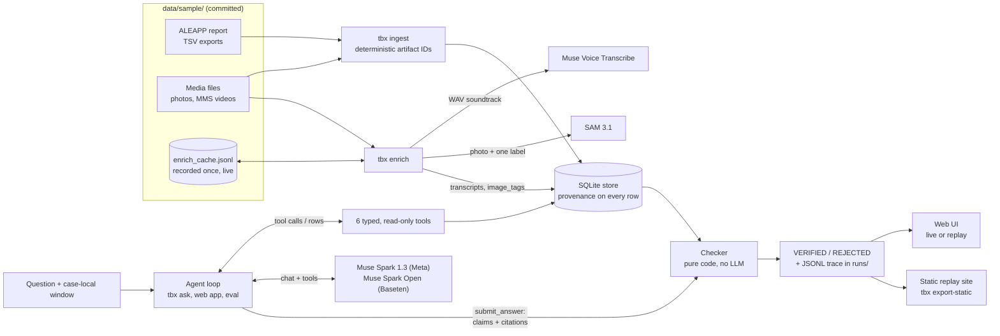

# Traceback

**An agent with typed forensic tools plus a deterministic citation verifier.**

A forensic examiner asks a question about a phone extraction ("Where was this phone between 9 and
11 pm, and who did it talk to?"). Traceback's agent, running on Meta's Muse Spark, queries the
parsed extraction through six typed tools and must submit its answer as structured claims. Each
claim cites artifact IDs, fields and values. A deterministic checker (pure code, no LLM)
verifies every citation against the store and rejects any claim it can't back up. Every
verified claim opens to the raw source row and its source path.

Built for the Meta Global AI Developer Hackathon, indie track ("Build for Your World").

> Status: Day 2. The core loop (ingest, tools, checker, agent, CLI) plus `tbx enrich` (voice transcripts and SAM 3.1
> image tags), the web app, the eval harness, the Modal deploy prep and a replay-only static site.
> See `docs/GAMEPLAN.md` and `docs/CONTRACTS.md`.

## Architecture



- **Ingest** maps ALEAPP's TSV exports and the media files onto six tables (`messages`, `calls`, `locations`, `media`,
  `transcripts`, `image_tags`). Each row keeps `source_path`, `source_row`, `ts_original`, `tz_basis` and the raw
  source row as `raw_json`. Its ID is `<prefix>_<sha1(source_path|row_key)[:10]>`, so it can be recomputed from its own
  provenance (CONTRACTS §2).
- **Tools** (`search_messages`, `get_calls`, `get_locations`, `find_media`, `get_transcripts`, `get_artifact`) are
  read-only, ordered deterministically and capped at 200 rows. They are the model's only view of the extraction.
- **The agent** loops on tool calls until the model calls `submit_answer`. It validates that call with pydantic,
  retries once on a failure, and caps the loop at 12 steps. `tool_choice` is always `"auto"`. Reasoning text is
  stripped and never sent back or traced.
- **The checker** decides what counts as a finding. Only verified claims reach the VERIFIED timeline; rejected claims
  are shown apart, with their reasons, and the model's `note` is labelled "Model note (not verified, not a finding)":
  the checker never looks at it.

## How verification works

Every claim is `{text, time_start?, time_end?, citations: [{artifact_id, field, value}]}`. `tbx.checker.check()` is
pure and deterministic (no network, no LLM, no clock; the same input gives byte-identical output) and **strict**: a
claim with any reason is rejected, and every reason is listed, with the index of the citation it applies to where
there is one. The reason codes are a stable API (CONTRACTS §7):

| Rule | Code | Rejects a claim when |
|---|---|---|
| R1 | `UNKNOWN_ARTIFACT` | a cited `artifact_id` is not in the store (for example a tool-call ID copied by mistake) |
| R2 | `UNKNOWN_FIELD` | the cited field is not citable for that table (`raw_json`, `tz_basis` and `ts_original` never are) |
| R2 | `VALUE_MISMATCH` | the cited value doesn't match the stored value after normalization |
| R3 | `OUTSIDE_WINDOW` | a question window is set and a cited artifact's time is outside it, or it has no timestamp |
| R4 | `UNGROUNDED_ENTITY:<type>` | the claim text names a phone number, email, URL, timestamp, date, clock time, coordinate or known contact that none of the claim's own cited values supports |
| R5 | `TIME_RANGE_UNSUPPORTED` | `time_start`/`time_end` is reversed, or falls outside the cited artifacts' times (±60 s; a call's end counts) |
| R6 | `NO_CITATIONS` | the claim cites nothing |

How values are compared:

| Kind | Fields | Rule |
|---|---|---|
| timestamp | `ts_utc`, `ts_local` | parsed and compared in UTC, to the second (to the minute when the cited value has no seconds) |
| phone | `number`, `*_number` | digits only; the last 10 digits when both sides have at least 10 |
| text | `body`, `text`, `transcript` | NFKC, casefold, collapsed whitespace; equal, or a quote of at least 8 characters from the stored text |
| coordinate | `lat`, `lon` | within 1e-4 |
| number / measure | `score` / `duration_s`, `accuracy_m`, `size_bytes` | within 1e-3 / within 1e-6, so `"95"` matches a stored `95` |
| everything else | | NFKC, casefold, collapsed whitespace; exact |

R4 extracts entities from the claim text in a fixed order (URL, email, timestamp, date, clock time, coordinate,
phone), so `2023-03-14T01:42:07Z` is one timestamp and not also a date, a clock time and a phone number. Dates and
clock times (`9:42 PM`, `21:42`) are grounded against the cited timestamps in the case timezone, and contact names
against the cited values. So a claim that restates the question window's times ("between 9:00 PM and 11:00 PM", or the
window's ISO bounds) is rejected unless a cited artifact carries those times: the window is not evidence. The system
prompt also tells the model never to restate the window.

**Quoted evidence (contract v1.4).** A passage of the claim text in double quotes (`"…"` or `“…”`) is a *verified
quote* when its normalized content has at least 8 characters and is part of the **stored** body, text or transcript
of a citation of the same claim that has no reason. Entities entirely inside a verified quote are grounded: the record
says them. So a quoted voicemail's "we're here until 9:00 p.m." is not compared with the voicemail's own timestamp,
while "At 9:00 PM she left a voicemail" still is, and so is a time inside a quote that isn't in the stored text. This
came from the first live eval, where all 5 rejected claims were word-for-word voicemail quotes rejected for the
times inside them (see "How we know the checker works").

On the page, each reason reads as one plain sentence built from the cited row, with the code in small type:
"Cited direction = 'outgoing'; the record says 'incoming'.", "'9:36 PM' doesn't match the cited record's time
(9:06 PM).", "This record is from Thu Jun 27, 2024 9:45:55 AM (UTC-04:00), outside the question window."
(`src/tbx/explain.py`). A wrong cited time is shown case-local on both sides ("The cited time (ts_local) is … 9:36:18
PM (UTC-04:00); the record's time is … 9:06:18 PM (UTC-04:00)."), and when one of the claim's citations failed, an
unbacked time or name reads "isn't backed by a correctly cited time" (or "value") instead.

With `--repair 1`, rejected claims and their reasons go back to the model once; the final report is the check of
its second answer, and the trace keeps both rounds. The page's repair view puts each round-1 rejected claim next to
what round 2 submitted for it: **corrected** (now verified), **dropped**, or **still rejected**. The red-team suite (`tests/redteam/`, 160 tests) pins every rule,
including real model claims recorded in the API spikes.

**What exactly was checked (contract v1.3).** The checker also returns `entities`: for every claim, each R4 entity it
found in the text, with its character span and whether it is grounded. The page colors the claim text with them,
and also with the words that match the value of a citation that passed (a cited label or name, a cited lat/lon or
measure within its tolerance, or a quoted passage of 8+ characters from a cited body, text or transcript; R4 entities
take precedence). Green = checked by code: a time, number or name that matches a cited row, or text quoted from one; red = not found in any cited row; plain text = the model's own words,
which are not verified. So "the phone was at a gas station" stays plain: only the cited values and the extracted
entities are checked, and the page says so.

**Recorded runs are re-checked on load.** When the web app (or `tbx export-static`) loads a recorded run, it runs
`check()` again on the recorded answer, with the recorded window, against the store, and compares the result with the
trace's `check_result`. The run header says "re-checked: same result"; any difference is shown as a warning on that
run, and `tbx export-static` lists it on stderr. Runs recorded before v1.3 get their highlighting from this re-check.

## How we know the checker works

- **Injected faults on real answers.** Every recorded answer in `deploy/runs/` (13 real runs) is first re-checked
  against the store, and every recorded verdict still holds: the claims it verified still verify, and the 12 real
  rejections in q10 (below) are rejected again with the same reason codes. Then each verified claim is broken in one
  controlled way at a time and re-checked: a cited value altered (a timestamp +1 minute, one phone digit, lat/lon
  +0.001, a quote cut to 5 characters, a label typo, a measure +2), a near-miss artifact ID, a `raw_json` citation, a
  wrong clock time, day or invented phone number in the text, or a time range on a day no cited row covers.
  Result: **577/577 injected faults rejected** (`TBX_STRICT_TESTS=1 pytest
  tests/acceptance/test_acceptance_fault_injection.py -s`). These are injected faults, labeled as such, not model
  errors. The testing session measured the same 577/577; on the first 12 runs it also got 508/508 with a separate
  v1.4 reference checker.
- **The live evals.** Eval 2 (Nov 3, this build, Meta on all 22 questions, repair off): 0 errors, 92 claims verified,
  12 rejected, and no rejection was a mistake. All 12 are from one answer (q10): the model wrote "Liz Dehner sent: …"
  but cited only the message's time and body, never its sender field. The names were right, but a claim its cited
  record doesn't back is rejected, true or not; that run is in the demo (`57a8b2`). Eval 1 (build `9e91df4`) had the
  opposite problem: 5 correct voicemail quotes were rejected for the times inside them, which contract v1.4 (quoted
  evidence) fixed; across every recorded answer and injected fault, v1.4 changes only those verdicts. (One
  open-weights *note* in Eval 1 got a fact wrong; notes are never findings, and the page labels them "not verified".)
- **The red-team suite** (`tests/redteam/`, 160 tests) pins every rule, with real model claims from the API spikes
  and from Eval 1 (case A24 is the q07 voicemail claim, verbatim).

## Meta tooling used

| Model | Where | What Traceback uses it for |
|---|---|---|
| **Muse Spark** `muse-spark-1.3` | Meta Model API (`/chat/completions`, OpenAI-compatible) | the agent: tool calls over the store, then `submit_answer`. The default provider, and the only one asked live on the hosted site. |
| **Muse Spark Open** `meta-models/muse-spark-open` | Baseten (`inference.baseten.co`) | the same agent on open weights (`--provider baseten`). It sometimes writes its tool call as text; the agent parses those blocks for known tool names only, marks them `tool_calls_from_text` in the trace, and the checker still verifies every claim. The hosted site replays recorded Baseten runs. |
| **Muse Voice Transcribe** `muse-voice-transcribe-1.0` | Meta Model API (`/asr/transcribe`, mode `ENDPOINTING`) | transcripts of the two MMS video soundtracks, the only recorded audio in the image. Sent as 24 kHz mono WAV with **no keyword biasing**, so the ASR can't be steered toward the case's names. |
| **SAM 3.1** `sam-3.1` | Meta Model API (`/responses`) | boxes on the 60 JPEG/PNG images (camera photos and image attachments), one request per label of prompt set `v1` (`person`, `cell phone`, `laptop`, `car`, `license plate`, `sign`). 225 boxes with score ≥ 0.5 become citable `image_tags` rows, drawn on the photo in the UI. |

Voice and SAM results are recorded once into `data/sample/derived/enrich_cache.jsonl`, so everything below runs
offline.

## Run everything offline (no keys, no credits)

```bash
python -m venv .venv && . .venv/bin/activate
pip install -e .
tbx ingest data/sample/aleapp --media-root data/sample/media --db data/tbx.db
tbx enrich --offline --db data/tbx.db       # 2 transcripts + 225 SAM tags from the committed cache
TBX_DB=data/tbx.db TBX_RUNS_DIR=deploy/runs uvicorn tbx.web:app --port 8000
```

Open http://127.0.0.1:8000. With no keys set, the page replays the recorded runs in `deploy/runs/` with no model call:
the trace's tool calls, the verified timeline, the rejected panel, and the evidence drawer with the raw row, the photo
with its SAM boxes, or the video with its transcript. `tbx check answer.json --db data/tbx.db` re-runs the checker on
any saved answer, and `TBX_STRICT_TESTS=1 pytest -q` runs all the suites offline.

The 13 recorded runs in `deploy/runs/` are real, unedited traces (`docs/gates/` keeps the originals). Each one
re-checks to the same result against the store built from the committed sample.

| Run | Model | Question | Result |
|---|---|---|---|
| `ae5039` (featured) | Meta | Where was this phone between 9 and 11 pm, and who did it talk to? | 5 verified |
| `3f05db` | open weights | the same question | 5 verified |
| `00584f` | Meta | What was said in the video messages this phone received? | 4 verified |
| `797bbf`, `1044ca` | open weights | What do the photos taken on July 24, 2024 show? (SAM tags) | 8, 10 verified |
| `61b070` | Meta | the same photos, and where they were taken | 5 verified |
| `a579c2` | Meta | the video messages of February 2024 (Voice Transcribe) | 6 verified |
| `febe0d`, `07b01f` | Meta, open weights | Who tried to reach the phone on the morning of July 27? (voicemail vs missed, carrier transcript) | 6, 6 verified |
| `a269f0` | Meta | Which photos taken July 15–17 show a license plate? (SAM + location) | 3 verified |
| `9b0b49` | Meta | Any contact with 919-579-4675? (a near-miss number exists) | 0 claims; the note explains |
| `416044` | Meta | Where was the phone 9–11 PM on July 15? (no data in the window) | 0 claims |
| `57a8b2` | Meta | What happened on Facebook Messenger between 1 and 2:30 PM on January 31, 2024? (Eval 2 q10) | 7 verified, 12 rejected: each named the sender without citing the sender field |

## Ask live

```bash
cp .env.example .env   # fill in keys locally; never commit .env
set -a; . ./.env; set +a   # tbx reads the environment, not the file
tbx ask "Where was this phone between 9 and 11 pm, and who did it talk to?" --from "2024-06-27 21:00" --to "2024-06-27 23:00"
tbx ask "What do the photos taken on July 24, 2024 show?" --from "2024-07-24 00:00" --to "2024-07-24 23:59" --provider baseten
```

A run costs about $0.05. In the web app, asks run the same agent code as `tbx ask` in a background thread and write
`runs/<run_id>.jsonl`.

## Web app

```bash
TBX_DB=data/tbx.db uvicorn tbx.web:app --port 8000   # then open http://127.0.0.1:8000
```

- **Ask:** a question with case-local From/To times and a provider toggle (meta | baseten).
- **Live providers:** `TBX_LIVE_PROVIDERS` (comma-separated, default `meta`) lists the providers this server asks
  live. Asking any other provider returns HTTP 403, and its toggle lists that provider's recorded runs to replay
  instead. `TBX_LIVE_PROVIDERS=meta,baseten` turns Baseten asks on; set but empty turns live asking off.
- **Replay:** every trace in `runs/*.jsonl` (or `TBX_RUNS_DIR`) is listed and replays with no model call. The newest
  good run (or `TBX_FEATURED_RUN`) opens by default. `TBX_RUNS_DIR=deploy/runs` replays the committed demo runs.
- **Run view:** status, the tool calls from the trace, a VERIFIED timeline in case-local time, and a REJECTED panel
  with one plain sentence per reason (the code in small type). Claim text is colored by what code checked (green),
  what failed (red) and what is the model's own wording (plain); the header shows the re-check made on load. Repaired
  runs show round 1 next to round 2 (corrected, dropped or still rejected).
- **Coverage:** built from the trace's tool calls, in plain English: for each evidence family (messages, calls and
  voicemail, locations, photos and media, voice transcripts) what was searched, with its time window, how many rows
  matched and how many the model saw ("Locations: 73 in the window, 50 shown; then all 73 with a higher limit."),
  and which families were never searched. A table lists every search with its case-local window.
- **Replay:** opening the page plays the featured run step by step in about 6 seconds (the tool calls, what they
  covered, the model's claims, then the checker's verdict lighting up the checked words), with a Skip button
  (or Escape); "Replay steps" plays any run again. A link to a run (`#run=<id>`) and `prefers-reduced-motion` open it
  without animation.
- **Export exhibit:** one click builds a self-contained HTML file in the browser (no scripts, no external files, so
  it also works on the static site): the question and its case-local window, the verified claims with their
  citations and the raw rows behind them, the rejected claims with their plain-English reasons, what was searched,
  and the provenance: the SHA-256 of `data/sample/MANIFEST.json`, the model ID, the Traceback version and git commit,
  and the SHA-256 of the run's trace file. It states: "Every claim was checked by deterministic code against the
  cited rows; the model's own wording is not verified."
- **Evidence drawer:** click any citation for the raw row (`raw_json`), `source_path` and `source_row`. Photos show
  their SAM 3.1 boxes scaled to the displayed size; videos show the Muse Voice Transcribe transcript; MMS rows show
  their attachment.
- **Limits:** `TBX_ASK_LIMIT_PER_HOUR` (default 30, then HTTP 429; `0` turns live asking off).

## Static replay site (GitHub Pages, no server)

```bash
tbx export-static --out site      # after ingest + enrich --offline; reads deploy/runs/ by default
python -m http.server -d site 8080   # check it locally at http://127.0.0.1:8080
```

`tbx export-static` drives the web app in-process and writes what the page reads as plain files: `index.html`,
`api/case.json`, `api/runs.json`, `api/runs/<id>.json`, `api/artifacts/<id>.json` for every cited row and the media
behind it, `api/media/<id>/tags.json` and `transcripts.json`, and the cited media files under `media/`. The page
detects static mode, reads those files with relative paths (so it works under `https://<user>.github.io/<repo>/`) and
disables the ask form with a short note. No server, keys or credits are involved, and the export refuses to finish if
a key value from the environment appears in any file.

To publish it on GitHub Pages (the repository must be public, or on a plan that allows Pages for private repos):

1. **With the included workflow:** in the repository, Settings → Pages → Build and deployment → Source: **GitHub
   Actions**. Then Actions → **Static replay site** → Run workflow. It rebuilds the store offline, exports `site/` and
   deploys it; the URL appears in the run summary (`https://<user>.github.io/<repo>/`). It only runs when started by
   hand.
2. **Or by hand, from a branch:** build `site/` as above, then put its contents on a `gh-pages` branch and choose
   Settings → Pages → Source: **Deploy from a branch** → `gh-pages` / `(root)`:

   ```bash
   git worktree add --orphan -b gh-pages ../tbx-pages   # git 2.42+
   cp -r site/. ../tbx-pages/
   git -C ../tbx-pages add -A
   git -C ../tbx-pages commit -m "Static replay site"
   git -C ../tbx-pages push -u origin gh-pages
   ```

## Deploy on Modal (prepared, not deployed)

`deploy/modal_app.py` serves `tbx.web` as an ASGI app. Its image copies this repo (never `.env` files, the local store
or local runs) and runs `tbx ingest` + `tbx enrich --offline` at build time, so the hosted store is built from the
same committed inputs as a local one, with the same artifact IDs, and the build needs no API key. Keys come only from a
Modal secret. The page replays a recorded run by default (`deploy/runs/*.jsonl`, copied into the `traceback-runs`
volume on start). Live asks go to Meta only (`TBX_LIVE_PROVIDERS=meta`) and are capped at `TBX_ASK_LIMIT_PER_HOUR`
(default 30 per hour, then HTTP 429); the baseten toggle replays the recorded Muse Spark Open runs.

Steps, once a Modal token exists (only the account owner can create one):

1. Create a token at modal.com (Settings → API tokens). On a laptop, `modal token new` stores it. For the Claude Code
   cloud environment, open the environment menu in the session's title bar → Edit, add `MODAL_TOKEN_ID` and
   `MODAL_TOKEN_SECRET` under Network secrets (or as environment variables where that section is not offered), and
   under Network access add `api.modal.com` (plus `modal.run` to open the deployed URL from there) to Allowed domains
   ([steps](https://code.claude.com/docs/en/cloud-environments#network-access)). A new session picks both up.
2. Install the CLI: `pip install -e '.[deploy]'` (or `pip install modal`).
3. Store the Meta key as a Modal secret (it is never baked into the image; no Baseten key is needed, since live asks
   are Meta-only): `modal secret create traceback-keys META_API_KEY=...`
4. Try it: `modal serve deploy/modal_app.py` prints a temporary URL with hot reload.
5. Deploy: `modal deploy deploy/modal_app.py` prints the stable `https://<workspace>--traceback-web.modal.run` URL.

To change the ask cap or the featured run, edit `TBX_ASK_LIMIT_PER_HOUR` / `FEATURED_RUN` in `deploy/modal_app.py` and
deploy again; `TBX_ASK_LIMIT_PER_HOUR=0` makes the site replay-only. `max_containers=1` keeps the cap global.

## Eval

```bash
python eval/run.py --provider meta --model muse-spark-1.3 [--repair 1]           # live, about $0.05 per question
python eval/run.py --provider baseten --model meta-models/muse-spark-open [--repair 1]
python eval/report.py --write                                                     # refresh the table below
```

`eval/run.py` sends every question in `eval/questions.yaml` through the same agent code as `tbx ask`, keeps each trace
in `runs/`, and writes `eval/results/<provider>-<model>[-repair].json` with per-question scores and the totals of
CONTRACTS §11 (fact recall, artifact recall, citation precision, `uncited_in_report`, rejections by reason,
abstention accuracy, latency p50/p95, tokens, cost).

## Eval results

<!-- eval-results:start -->
| Provider | Model | Repair | Questions | Fact recall | Artifact recall | Citation precision | Abstention | Uncited | Rejected (top reasons) | p50 / p95 latency | Tokens | Cost |
|---|---|---|---|---|---|---|---|---|---|---|---|---|
| baseten | `meta-models/muse-spark-open` | no | 4 | 100% | 100% | 100% | 100% | 0 | 0 | 10.5 s / 22.7 s | 367,687 | $0.23 |
| meta | `muse-spark-1.3` | no | 22 | 93% | 98% | 88% | 100% | 0 | 12 (UNGROUNDED_ENTITY:contact 22) | 24.4 s / 73.8 s | 1,037,161 | $1.14 |

From `eval/results/baseten-meta-models_muse-spark-open-4traps.json`, `eval/results/meta-muse-spark-1.3.json`; questions: `eval/questions.yaml`. Rendered by `eval/report.py`.
<!-- eval-results:end -->

Meta ran all 22 questions on build `26fe454` (Nov 3, repair off). The open-weights row is a 4-question trap subset
(q06, q08, q15, q21) from Eval 1 on build `9e91df4`, run that way to save credit; re-scored with this build's checker,
its numbers don't change. All 12 rejected Meta claims come from q10: each named the right sender but didn't cite the
sender field (see "How we know the checker works"). They count 22 reasons because the contact list spells one name
three ways ("ThisIs DFIR", "ThisIs Dfir", "thisis dfir"), and each spelling gives a reason. q11's fact recall of 0 is
our scoring mistake: it expected the caller's number, which the question didn't ask for; the answer listed all four
calls correctly.

## Data provenance

The sample is a cut-down excerpt of the ALEAPP report for the public **Android 14 reference image** created by
**Joshua Hickman** and distributed by **Digital Corpora** (a Google Pixel 7a, Android 14, Google Fi; persona
"Liz Dehner", populated Jan 26 – Jul 28, 2024; case timezone `America/New_York`). `data/sample/SOURCE.md` has the full
record: the archive's SHA-256, the extraction path inside it, the ALEAPP version and commit, and the license terms.

- Every TSV row in `data/sample/aleapp/_TSV Exports/` is real ALEAPP output, copied byte for byte, so row numbers and
  the artifact IDs derived from them match the full report. No row was added or edited, and nothing was synthesized.
- `data/sample/media/` mirrors the extraction root: 40 camera photos (downscaled to at most 1,600 px, EXIF kept) and
  26 Google Messages attachments, verbatim, including the two MMS videos. `MANIFEST.json` lists every file's hash and
  the original's hash.
- `data/sample/derived/enrich_cache.jsonl` is machine output (Muse Voice Transcribe and SAM 3.1), not evidence from
  the image.
- Digital Corpora's original content is CC0. Third-party content inside the image (app assets, marketing images and
  videos received by SMS) belongs to its owners and is kept as evidence excerpts for research and demonstration.
  Traceback's own code is Apache-2.0; that license does not cover `data/sample/`.

## Limitations

- **Prose and place names aren't checked.** The checker verifies the cited values and the entities it can extract
  (phones, emails, URLs, dates, clock times, coordinates, known contacts). Free text such as "at a gas station" or
  "near Raleigh" is not verified. A verified claim is backed by real rows, but an examiner still reviews it.
- **SAM and ASR output is machine output.** A `tag_` row means SAM 3.1 drew that box with that score, not that the
  object is there: "shows a person" can rest on an arm at the edge of a photo (person 0.88). Transcripts can mishear
  names; the two MMS soundtracks spell the same candidate "Satana Deberry" and "Satana Dewberry". The UI marks both as
  machine output.
- **An MMS can appear as several rows.** ALEAPP lists an MMS's text and each attachment as separate message rows with
  the same `thread_id` and time. The prompt tells the model to describe them as one message, but a model can still
  count them separately.
- **The image has no voice notes.** The 2,154 Google Fi voicemail files are 0 bytes (the audio stays with the
  carrier). Only the carrier's transcription text survives, for 49 of them, as `calls.transcript`, and it can't be
  checked against audio. The only recorded audio is the soundtrack of the two MMS videos.
- **Phone numbers compare on the last 10 digits**, so two numbers that differ only in their country code match.
- **Photo coordinates are rounded to 7 decimals** at ingest (about 1 cm); the EXIF rationals stay in `raw_json`.
- **WhatsApp system messages have no direction.** ALEAPP labels every WhatsApp "System Message" row (group created,
  member joined, security code changed) "Outgoing", though the phone's user sent none of them. In the sample that is
  120 group rows (spam-group creations and joins, e.g. "Crypto market9") and 45 one-to-one rows. Ingest stores their
  `direction` as `unknown`, so "the phone sent 'Crypto market9'" can't verify; their IDs are unchanged and ALEAPP's own
  label stays in `raw_json`.
- **One Google Voice message body is undecoded.** ALEAPP exported the body of the incoming Google Voice message of
  Feb 27, 2024, 10:47 AM (`msg_a77990bad4`) as a raw protobuf dict, `{'9': 7214873393859748128, '12': …}`, not as
  text. Traceback stores it as found; whatever the message said is not in the extraction we parse.

## Layout

| Path | What |
|---|---|
| `src/tbx/timeutil.py` | the one module that converts local ⇄ UTC |
| `src/tbx/store.py` | SQLite store with provenance on every row |
| `src/tbx/ingest.py` | ALEAPP report → store, with deterministic artifact IDs |
| `src/tbx/tools.py` | the six typed tools the agent calls |
| `src/tbx/checker.py` | the deterministic citation checker |
| `src/tbx/runview.py` | recorded runs re-checked on load: the re-check verdict, the entity spans the page colors, the repair view |
| `src/tbx/explain.py` | one plain-English sentence per rejection reason, from the cited row |
| `src/tbx/coverage.py` | what the agent searched (and never searched), from the trace's tool calls |
| `src/tbx/enrich.py` | `tbx enrich`: Muse Voice Transcribe and SAM 3.1, cached in `data/sample/derived/enrich_cache.jsonl` |
| `src/tbx/agent.py` | the tool loop, `submit_answer` validation and the JSONL trace |
| `src/tbx/web/` | `tbx.web`: the FastAPI app and its single HTML page (no build step) |
| `src/tbx/export_static.py` | `tbx export-static`: the replay-only static site |
| `src/tbx/cli.py` | `tbx ingest`, `tbx enrich`, `tbx ask`, `tbx check`, `tbx export-static` |
| `deploy/` | `modal_app.py` (hosted web app) and `runs/` (recorded demo runs it replays) |
| `src/tbx/evaluation.py`, `eval/` | the eval harness (`eval/run.py`) and the README table (`eval/report.py`) |
| `data/sample/` | cut-down ALEAPP output from a public reference image (see `data/sample/SOURCE.md`) |

## Contributors

- Amit Chowdary
- Devalla Ashvitha

## License

Apache-2.0. See `LICENSE`.
